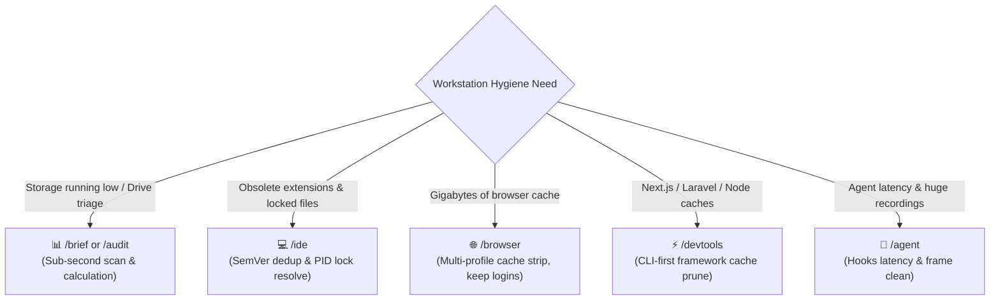
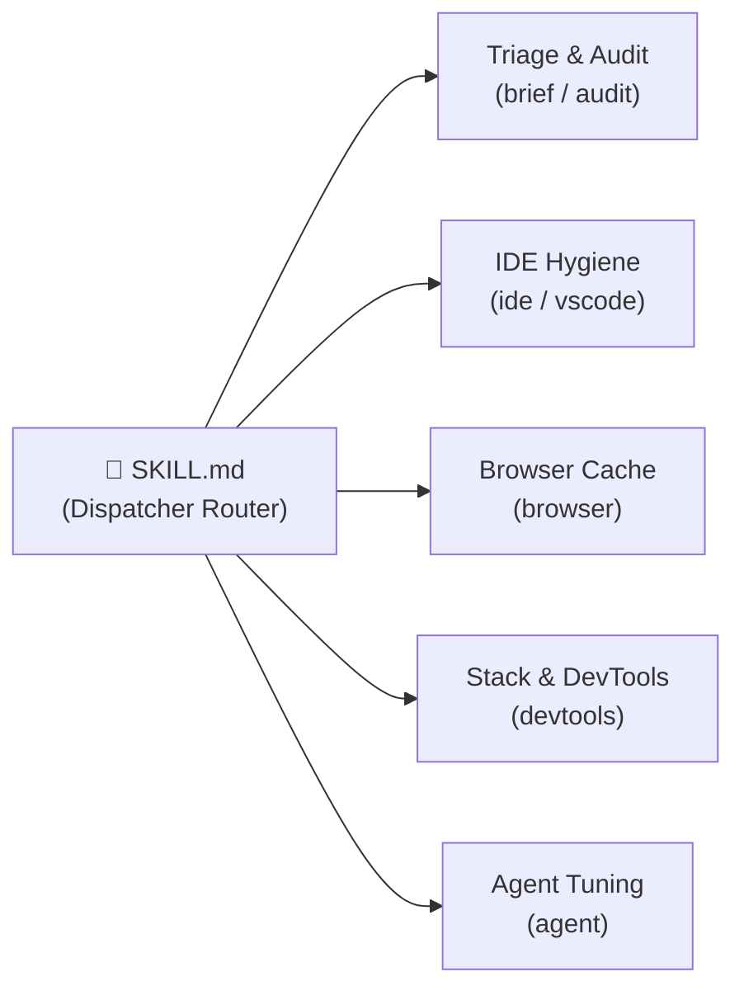
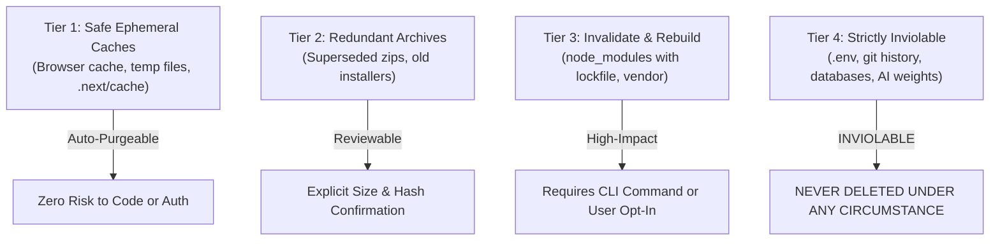

<div align="center">

# 🧹 TidyFactor Cleaner `v1.3.0`
### The Universal Developer Workstation, IDE, Framework & System Hygiene Engine for AI Coding Agents

Give **Google Antigravity, Claude Code, Cursor, OpenAI Codex, or Windsurf** a deterministic, multi-tier system hygiene engine that reclaims tens of gigabytes across your developer workstation — without breaking active sessions, deleting browser credentials, or triggering process lock deadlocks.

[](https://www.npmjs.com/package/@tidyfactor/cleaner)
[](https://github.com/TidyFactor/Cleaner/stargazers)
[](LICENSE)
[](https://github.com/TidyFactor)
[](SKILL.md)
[]()
[-green.svg?style=for-the-badge)](#%EF%B8%8F-tidyfactor-skill-methodology--governance)
[](SKILL.md)

[ English ](README.md) • [ العربية ](README.ar.md) • [ فارسی ](README.fa.md) • [ Español ](README.es.md) • [ Português ](README.pt.md) • [ 简体中文 ](README.zh.md) • [ Deutsch ](README.de.md) • [ Français ](README.fr.md)

<br/>

</div>

---

## 📚 Table of Contents

- [🎯 Why TidyFactor/Cleaner](#-why-tidyfactorcleaner)
- [🚀 Quick Start & Installation](#-quick-start--installation)
- [🌟 Value Proposition: When to Use Cleaner?](#-value-proposition-when-to-use-cleaner)
- [⚡ 5-Stage Command Dispatcher Architecture](#-5-stage-command-dispatcher-architecture)
- [🛠️ The 5 Production Workflows](#%EF%B8%8F-the-5-production-workflows)
- [🌐 Supported Production Stacks & Environments](#-supported-production-stacks--environments)
- [🛡️ Inviolable Data & Process Safety Engineering](#%EF%B8%8F-inviolable-data--process-safety-engineering)
  - [1. The 4-Tier Project Safety Matrix](#1-the-4-tier-project-safety-matrix)
  - [2. The Daemon & Language Server Lock Protocol](#2-the-daemon--language-server-lock-protocol)
- [❓ FAQ](#-faq)
- [🏛️ The TidyFactor Ecosystem](#%EF%B8%8F-the-tidyfactor-ecosystem)
- [🏛️ TidyFactor Skill Methodology & Governance](#%EF%B8%8F-tidyfactor-skill-methodology--governance)
- [🤝 Contributing](#-contributing)
- [👨‍💻 Organization & Support](#-organization--support)
- [📜 License](#-license)

---

## 🎯 Why TidyFactor/Cleaner

> [!IMPORTANT]
> **The Cleaner Manifesto: Why Raw Disk Cleanup Fails Developers**  
> Conventional disk cleanup utilities (CCleaner, CleanMyMac, Windows Storage Sense) and naive shell scripts (`rm -rf`) are lethal to developer workflows:
> 1. They don't understand semantic extension versioning, leaving gigabytes of duplicate VS Code extension roots.
> 2. They fail with `Access is denied` or `unlinkat` when background language servers (`gopls`, `tsserver`, `intelephense`, `codex-code-mode-host`) hold file locks.
> 3. They blindly purge browser databases, destroying authenticated sessions, local storage, saved passwords, and cookies.
> 4. They hang for minutes when recursively traversing deep `node_modules` or `.git` trees.
> 
> **TidyFactor Cleaner is the surgical, developer-aware antidote:** It enforces non-blocking fast diagnostic pruning, strict multi-profile browser cache isolation, daemon lock resolution, and a 4-tier project safety matrix that guards your local AI models, `.env` secrets, and repositories.

| Dimension | Standard Cleaners / Naive Scripts | `tidyfactor-cleaner` |
|---|---|---|
| **Diagnostic Scanning** | Freezes for minutes traversing nested `node_modules` and `.git` | **Sub-second fast exclusion scans** via Robocopy summary & POSIX `find -prune` |
| **VS Code / IDE Extensions** | Ignores extension folders or wipes all custom extensions | **Semantic version deduplication**: keeps newest SemVer, removes superseded duplicates |
| **Browser Cache Cleanup** | Destroys cookies, logins, session storage, and bookmarks | **Inviolable isolation**: strips only web, code, GPU, and service worker caches |
| **Process Lock Handling** | Fails with `Access is denied` or crashes silently | **PID-aware daemon resolution** (`gopls`, `tsserver`, `codex-code-mode-host`, `kilo`) |
| **Framework Intelligence** | Clueless about Next.js, Nuxt, Laravel, or Docker | **CLI-first stack orchestration** (`artisan optimize:clear`, Docker prune, build stores) |
| **AI Model & Secret Safety** | Risks wiping local LLM weights or dotfiles | **Tier 4 Protected**: `.gguf`, `.safetensors`, `.env*`, and databases are strictly inviolable |
| **Agent Context Overhead** | Monolithic prompt dumps consuming 10k+ tokens | **Lean router (`SKILL.md`)** loading ~350 tokens at launch, pulling memory on demand |

### ⚡ The Before & After Difference: Naive Shell Cleanup vs. TidyFactor Cleaner

````carousel
```powershell
# ❌ NAIVE CLEANUP SCRIPT (Risky, Hanging, Lock-Prone)
Get-ChildItem -Path "$env:USERPROFILE" -Recurse | Where-Object { $_.Name -eq "Cache" } | Remove-Item -Recurse -Force
# Disasters:
# 1. Hangs indefinitely iterating millions of files in AppData and node_modules.
# 2. Crashes when gopls.exe or vscode-eslint holds open file handles.
# 3. Blindly deletes browser session tokens and logged-in cookie stores.
# 4. Wipes uncommitted developer experiments without confirmation.
```
<!-- slide -->
```powershell
# ✅ TIDYFACTOR CLEANER SURGICAL ORCHESTRATION (Deterministic, Safe, Non-Blocking)
# 1. Sub-second Robocopy exclusion scan (pruning node_modules, .git, vendor)
robocopy "$env:LOCALAPPDATA\Google\Chrome\User Data" "$env:TEMP\null" /L /S /BYTES /XJ /XD node_modules .git /MIN:10485760
# 2. Strict cache partition targeting (Only Cache_Data, Code Cache, GPUCache)
# 3. Preserves Login Data, Cookies, Bookmarks, and Sessions (SSOT Protected)
# 4. Detects daemon PIDs holding locks and offers graceful daemon restart
# 5. Presents exact reclaimable MB/GB projection with interactive confirmation
```
````

---

## 🚀 Quick Start & Installation

Choose your preferred installation method:

### Option A: Via TidyFactor CLI (Recommended)
Install directly using the official ecosystem package runner into your active workspace:
```bash
npx @tidyfactor/cli add cleaner
```
*Or if you have the CLI installed globally (`npm i -g @tidyfactor/cli`):*
```bash
tidyfactor add cleaner
```

### Option B: Via Open Agent Skills Ecosystem (skills.sh / Vercel Labs)
Install using the universal multi-agent standard across all supported IDEs (Cursor, Antigravity, Claude Code, Windsurf, Trae, Codex):
```bash
npx skills add tidyfactor/cleaner
```

### Option C: Standalone Zero-Dependency Runner (NPM Direct)
Run the dedicated skill installer directly with automatic cache invalidation:
```bash
npx @tidyfactor/cleaner@latest
```

### 2. Workspace Installation per AI Agent

| AI Agent | Workspace Skill Path |
|---|---|
| **Google Antigravity** | `.agents/skills/tidyfactor-cleaner/` or global `~/.gemini/config/skills/` |
| **Claude Code** | `.claude-skill/skills/tidyfactor-cleaner/` |
| **Cursor / Codex / Windsurf** | `.agents/skills/tidyfactor-cleaner/` |

Once installed, simply invoke `/brief`, `/ide`, `/browser`, `/devtools`, or `/agent` inside your AI agent chat to begin surgical workstation hygiene!

---

## 🌟 Value Proposition: When to Use Cleaner?



| For Developers | For DevOps & Fullstack Teams | For AI Coding Agents |
|---|---|---|
| **Zero Login Disruption**: Purge browser bloat without losing GitHub, staging, or dashboard credentials. | **Universal Framework Coverage**: Cleans Next.js, Nuxt, Vite, Laravel, Symfony, and Docker stores cleanly. | **Lean Router Footprint**: `SKILL.md` dispatcher loads ~350 tokens, preventing agent context saturation. |
| **Semantic Extension Pruning**: Reclaims 5–15 GB from duplicate and obsolete IDE extensions automatically. | **Cross-Platform Parity**: Identical operational guarantees across Windows (Robocopy), macOS, and Linux (`find`). | **Process Lock Immunity**: Automatically detects and terminates zombie daemons blocking cache unlinks. |
| **Non-Blocking Diagnostics**: Fast pruning algorithms eliminate terminal hangs on multi-gigabyte trees. | **Zero Data Destruction**: Absolute immunity for `.env` secrets, database files, and local AI model weights. | **Interactive CDL Governance**: Generates precise multi-choice confirmation proposals before deletion. |

---

## ⚡ 5-Stage Command Dispatcher Architecture

`tidyfactor-cleaner` exposes **5 precision slash commands** organized into a modular dispatch architecture:



| Command | User Intent | What It Loads | Output & Value |
|---|---|---|---|
| `brief` / `audit` | "Scan disk space" / "Where is storage going?" | `workflows/diagnose-storage.md` + `memory/storage-matrix.md` | Non-blocking triage breakdown, reclaimable megabytes calculation, and A/B/C/D action plan. |
| `ide` / `vscode` | "Clean VS Code" / "Remove old extensions" | `workflows/clean-ide.md` + `memory/lock-matrix.md` | Prunes superseded extension versions, clears `.vsix` caches, and resolves zombie process locks. |
| `browser` | "Clean browser cache without losing logins" | `workflows/clean-browser.md` + `memory/safety-matrix.md` | Purges pure HTTP, GPU, and code caches across all Chrome/Edge/Brave profiles while preserving auth. |
| `devtools` | "Prune package caches" / "Clean Next.js / Laravel" | `workflows/clean-devtools.md` + `memory/storage-matrix.md` | CLI-first cleanup (`artisan`, `cargo`, `pnpm`, `docker`) with surgical filesystem fallback. |
| `agent` | "Speed up agent" / "Clean recordings" | `workflows/tune-agent.md` + `memory/agent-tuning.md` | Audits hook latency, deletes ephemeral browser recording frames, and hardens watcher ignores. |

---

## 🛠️ The 5 Production Workflows

Every task follows a strict, single-outcome workflow ending in an automated validation checklist:

1. **`diagnose-storage.md`**: Auto-Sensing System Inspection $\rightarrow$ Robocopy / POSIX Fast Pruning Scan $\rightarrow$ Multi-Tier Storage Breakdown $\rightarrow$ Interactive Confirmation Proposal.
2. **`clean-ide.md`**: Extension Directory Scan $\rightarrow$ SemVer Version Parsing $\rightarrow$ Lock & PID Check $\rightarrow$ Duplicate Elimination $\rightarrow$ Reclaim Verification.
3. **`clean-browser.md`**: Multi-Profile Discovery $\rightarrow$ Auth Files Whitelisting (`Login Data`, `Cookies`) $\rightarrow$ Cache Data Partition Purge $\rightarrow$ Disk Space Verification.
4. **`clean-devtools.md`**: Toolchain Auto-Detection $\rightarrow$ CLI Command Execution (`optimize:clear`, `go clean`) $\rightarrow$ Stale Build Artifact Pruning $\rightarrow$ Safety Guard Check.
5. **`tune-agent.md`**: Agent Hook Latency Audit $\rightarrow$ Ephemeral Screen Recording Purge $\rightarrow$ File System Watcher Hardening $\rightarrow$ Zero-Bloat Reclaim.

---

## 🌐 Supported Production Stacks & Environments

`tidyfactor-cleaner` auto-senses the host environment and adapts dynamically to active stacks:

| Environment Category | Supported Targets | Hygiene Capabilities |
|---|---|---|
| **Operating Systems** | Windows 10/11, macOS, Ubuntu / Debian / RHEL | Robocopy summary scans, POSIX `find -prune`, `$HOME` / AppData resolution |
| **IDEs & Editors** | VS Code, Google Antigravity, Cursor, Windsurf | Obsolete extension dedup, `.vsix` purge, `codex-code-mode-host` lock release |
| **Browsers (Multi-Profile)** | Google Chrome, Microsoft Edge, Brave, Chromium | `Default` + `Profile *` pure cache strip, zero auth/credential loss |
| **Web Frameworks** | Next.js, React/Vite, Nuxt, Laravel, Symfony, WordPress | `.next/cache`, Turbopack, `storage/framework/views`, `bootstrap/cache` |
| **Package Managers** | PNPM, Bun, NPM, Yarn, Composer, Cargo, Go, Pip | Store pruning, build artifacts, locked module safety verification |
| **Containers & Virtualization** | Docker, WSL2, Local Virtual Hosts | Dangling image cleanup, build cache release, log truncation |

---

## 🛡️ Inviolable Data & Process Safety Engineering

### 1. The 4-Tier Project Safety Matrix

`tidyfactor-cleaner` classifies every file and directory under a strict 4-tier safety model:



| Tier | Category | Examples | Policy |
|---|---|---|---|
| **Tier 1** | Pure Disposable Cache | `Cache_Data`, `GPUCache`, `.next/cache`, `~/.npm/_cacache` | **Safe to purge**: Rebuilds automatically with zero user intervention. |
| **Tier 2** | Redundant Archives | Old installer `.exe` / `.msi`, duplicate backup `.zip` files | **Review required**: Listed with age, size, and hash before deletion. |
| **Tier 3** | Re-installable Stores | `node_modules/`, `vendor/`, `.venv/` | **Lockfile required**: Only pruned if `package-lock.json` or `composer.lock` exists. |
| **Tier 4** | **Inviolable Data** | **`Login Data`, `Cookies`, `.env*`, `.git/`, SQLite/MySQL, `.gguf`, `.safetensors`** | **STRICTLY BLOCKED**: No delete command is ever emitted for these assets. |

### 2. The Daemon & Language Server Lock Protocol

When background language servers hold file locks, standard deletion commands crash with `Access is denied` or leave orphan unlinked files. `tidyfactor-cleaner` handles process locks with deterministic discipline:

```
[Lock Detection Engine]
  │
  ├── 1. Identifies locking PID (e.g. gopls.exe, tsserver.js, intelephense)
  ├── 2. Issues graceful shutdown request to daemon
  ├── 3. If unresponsive after 3000ms: presents user prompt with PID details
  └── 4. Re-attempts cache directory removal with verified lock release
```

---

## ❓ FAQ

<details>
<summary><b>Will running <code>/browser</code> log me out of my websites or delete my saved passwords?</b></summary>
<br/>
<b>Never.</b> TidyFactor Cleaner explicitly isolates and protects <code>Login Data</code>, <code>Cookies</code>, <code>Bookmarks</code>, <code>Preferences</code>, and active <code>Sessions</code>. It purges only ephemeral web content, GPU caches, compiled code cache, and service worker blobs.
</details>

<details>
<summary><b>How does Cleaner avoid hanging when scanning massive project directories?</b></summary>
<br/>
Standard tools perform deep recursive file walks. Cleaner uses <b>fast exclusion summary scanners</b>: on Windows it utilizes Robocopy with <code>/L /S /BYTES /XJ /XD node_modules .git vendor</code>, and on Linux/macOS it executes POSIX <code>find</code> with strict <code>-prune</code> parameters. This evaluates multi-gigabyte workspaces in milliseconds.
</details>

<details>
<summary><b>What happens to obsolete VS Code extensions?</b></summary>
<br/>
Cleaner parses extension directory folder names using Semantic Versioning (SemVer). If you have both <code>publisher.extension-1.2.0</code> and <code>publisher.extension-1.3.1</code>, Cleaner keeps <code>1.3.1</code> and removes <code>1.2.0</code>, instantly freeing gigabytes of redundant dependencies.
</details>

<details>
<summary><b>Will Cleaner delete my local AI models or LLM weights?</b></summary>
<br/>
<b>Strictly No.</b> Local AI weights (including <code>.gguf</code>, <code>.safetensors</code>, <code>.bin</code>, and Ollama/LM Studio model storage) are categorized as <b>Tier 4 Inviolable Data</b> and are completely immune to automated deletion.
</details>

---

## 🏛️ The TidyFactor Ecosystem

**TidyFactor** is a modular web architecture and AI coding agent skill ecosystem built on clear separation of concerns across the product lifecycle:

```
TidyFactor Organization (github.com/TidyFactor)
│
├── Hygiene & Foundation
│   ├── Cleaner      → Workstation & System   (Universal IDE, Framework & Storage Hygiene)
│   └── Skill-Arch   → Agent Governance       (Master 14-Rule Architectural Governance)
│
├── Design Skills
│   ├── Cinematic    → Experience / "Wow"     (Apple × Cartier Scroll-Driven Landing Pages)
│   ├── Design       → Prototype / "Build"    (Code-Native UI Design Engine & Figma Alternative)
│   └── Styler       → Production / "Ship"    (Framework Styler & RTL Polish Engine)
│
├── Development Skills
│   ├── HTML         → Content & Static       (Semantic SEO & Static Platform Starter)
│   ├── HTMX         → Hypermedia             (Server-Driven Micro-Interactions)
│   ├── JS           → Vanilla SPA            (Framework-Free Reactive ES Modules)
│   ├── PHP          → Server-Rendered        (Modern PHP 8.x Component UI & Architecture)
│   └── Next         → Multi-Tenant SaaS      (Next.js 16, React 19, Supabase RLS & Dev-Perf)
│
└── Growth Skills
    └── Marketing    → Growth / Revenue       (Direct Response, Pillar SEO & Content Lifecycles)
```

### 📦 Community Package & Skill Parity

| Track | Category | GitHub Repository | Agent Skill | NPM Package |
| :--- | :--- | :--- | :--- | :--- |
| **Cleaner** | Hygiene | [`TidyFactor/Cleaner`](https://github.com/TidyFactor/Cleaner) | `tidyfactor-cleaner` | [`@tidyfactor/cleaner`](https://www.npmjs.com/package/@tidyfactor/cleaner) |
| **Styler** | Design | [`TidyFactor/Styler`](https://github.com/TidyFactor/Styler) | `tidyfactor-styler` | [`@tidyfactor/styler`](https://www.npmjs.com/package/@tidyfactor/styler) |
| **Design** | Design | [`TidyFactor/Design`](https://github.com/TidyFactor/Design) | `tidyfactor-design` | [`@tidyfactor/design`](https://www.npmjs.com/package/@tidyfactor/design) |
| **Cinematic** | Design | [`TidyFactor/Cinematic`](https://github.com/TidyFactor/Cinematic) | `tidyfactor-cinematic` | [`@tidyfactor/cinematic`](https://www.npmjs.com/package/@tidyfactor/cinematic) |
| **Next** | Development | [`TidyFactor/Next`](https://github.com/TidyFactor/Next) | `tidyfactor-next` | [`@tidyfactor/next`](https://www.npmjs.com/package/@tidyfactor/next) |
| **HTML** | Development | [`TidyFactor/HTML`](https://github.com/TidyFactor/HTML) | `tidyfactor-html` | [`@tidyfactor/html`](https://www.npmjs.com/package/@tidyfactor/html) |
| **HTMX** | Development | [`TidyFactor/HTMX`](https://github.com/TidyFactor/HTMX) | `tidyfactor-htmx` | [`@tidyfactor/htmx`](https://www.npmjs.com/package/@tidyfactor/htmx) |
| **JS** | Development | [`TidyFactor/JS`](https://github.com/TidyFactor/JS) | `tidyfactor-js` | [`@tidyfactor/js`](https://www.npmjs.com/package/@tidyfactor/js) |
| **PHP** | Development | [`TidyFactor/PHP`](https://github.com/TidyFactor/PHP) | `tidyfactor-php` | [`@tidyfactor/php`](https://www.npmjs.com/package/@tidyfactor/php) |
| **Marketing** | Growth | [`TidyFactor/Marketing`](https://github.com/TidyFactor/Marketing) | `tidyfactor-marketing` | [`@tidyfactor/marketing`](https://www.npmjs.com/package/@tidyfactor/marketing) |

---

## 🏛️ TidyFactor Skill Methodology & Governance

`tidyfactor-cleaner` satisfies all **14 Architectural Governance Rules** under [`tidyfactor-skill-architect`](https://github.com/TidyFactor/Skill-Architect):

1. ✅ **Dispatcher Discipline**: `SKILL.md` routes commands without executing tasks (~350 tokens).
2. ✅ **One Workflow = One Outcome**: Every workflow has a single deliverable with an explicit validation checklist.
3. ✅ **Operational Memory**: Pure storage matrix schemas, daemon lock signatures, and safety invariants—zero narrative prose.
4. ✅ **No Empty Structures**: Clean, flattened architecture without single-file folders.
5. ✅ **Philosophy Isolation**: Technical execution separated from marketing commentary.
6. ✅ **Trigger-Justified Growth**: Commands added per verifiable workstation hygiene stages.
7. ✅ **Security & Safety Invariant**: Inviolable credentials, session protection, and 4-tier safety model.
8. ✅ **Cross-Platform Parity**: 100% identical behavior across Windows, macOS, and Linux.
9. ✅ **Platform Compatibility**: Frontmatter double-quotes and valid YAML parsing.
10. ✅ **Tool Permission Declaration**: Explicit scope for tools and mutations.
11. ✅ **Memory Freshness**: Operational memory timestamps (`last-verified: 2026-10-21`).
12. ✅ **Skill vs MCP Boundary**: Knowledge in skills, live state in CLI / system tools.
13. ✅ **Two-Tier Multi-Language Documentation**: Canonical technical documentation + 8-language localized guides.
14. ✅ **Auto-Sensing First**: Zero questions about OS, drive letters, or system paths.

---

## 🤝 Contributing

We welcome community contributions, custom toolchain adapters, and workflow refinements!

Please read our `CONTRIBUTING.md` and `CODE_OF_CONDUCT.md` before opening a Pull Request. All proposed workflows and memory extensions must satisfy the `tidyfactor-skill-architect` governance rules.

---

## 👨‍💻 Organization & Support

- 🌐 **Official Website:** [https://tidyfactor.com/](https://tidyfactor.com/)
- 📚 **Official Documentation:** [https://tidyfactor.com/documentation](https://tidyfactor.com/documentation)
- 🤝 **Official Partner Website:** [Alwkala Digital Agency](https://alwkala.com/)
- 🐙 **GitHub Organization:** [github.com/TidyFactor](https://github.com/TidyFactor)
- 📧 **Business Inquiries:** [hello@tidyfactor.com](mailto:hello@tidyfactor.com)
- 📱 **WhatsApp:** [+20 101 665 6899](https://wa.me/201016656899)
- 📞 **Phone:** +20 101 665 6899
- 📍 **Location:** Cairo, Egypt

---

## 📜 License

Licensed under the **MIT License**. Copyright (c) 2026 [TidyFactor](https://tidyfactor.com) & [Alwkala](https://alwkala.com).
